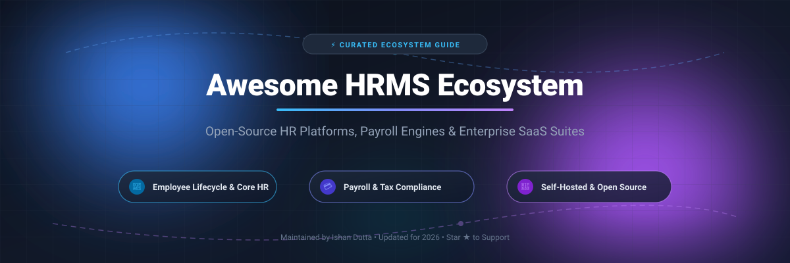

# 🌟 Awesome Human Resources Management System (HRMS)

### Curated Directory of Enterprise SaaS Suites & Self-Hosted Open-Source HR Platforms

  
  
  
  
  
  
  

**A curated ecosystem guide tracking modern HRMS, Core HR, Payroll Automation, ATS (Applicant Tracking), Employee Lifecycle Management, and Self-Hosted HRIS solutions.**

---

## 📑 Table of Contents

- [📊 Sector Overview & Market Dynamics](#-sector-overview--market-dynamics)
- [💼 Top Commercial SaaS Platforms](#-top-commercial-saas-platforms)
- [🚀 Open-Source GitHub Projects](#-open-source-github-projects)
- [🤝 How to Contribute](#-how-to-contribute)
- [📈 Star History](#-star-history)
- [💖 Support & Sponsorship](#-support--sponsorship)
- [⚖️ Disclaimer](#️-disclaimer)

---

## 📊 Sector Overview & Market Dynamics

The global Human Resources Management System (HRMS) and Core HR software market is estimated at **$21B–$25B in 2025** (scaling to over **$35B by 2030** at ~10–12% CAGR), driven by remote-work compliance, payroll automation, and AI-enabled talent workflows. 

The sector is **moderately to highly fragmented** rather than winner-take-all:
- **Enterprise Tier**: Mega-vendors (Workday, ADP, SAP SuccessFactors, Oracle Cloud HCM) dominate global enterprise accounts with heavy multi-country compliance and complex ERP integrations.
- **Mid-Market & Fast-Growing Scale-ups**: Contested aggressively by modern, unified platforms (Rippling, Gusto, Personio, BambooHR) that bundle HR with corporate IT, device provisioning, and modern benefits.
- **Self-Hosted & Open-Source Tier**: Booming rapidly due to data sovereignty mandates (GDPR/HIPAA), custom labor regulations, and organizations rejecting compounding per-seat SaaS subscription fees.

---

## 💼 Top Commercial SaaS Platforms

*Ranked in descending order by estimated enterprise valuation / market capitalization.*

| Product | Description | Market Size / Valuation | Pricing (Starting Tier) | Free Tier / Trial Limits |
|:---|:---|:---:|:---:|:---|
| **[Workday HCM](https://www.workday.com/)** | 🏢 Enterprise HCM standard for global core HR, payroll, benefits, and talent intelligence. | **~$45B–$48B Market Cap** ($9.55B FY26 Revenue) | **~$35–$42/employee/month** (enterprise packages typically require 3-year commitment with $100K–$200K annual minimums) | No permanent free plan; no self-service trial (evaluation via scheduled guided sales demo only) |
| **[Rippling](https://www.rippling.com/)** | ⚡ Unified workforce management platform natively syncing HR, automated payroll, IT device management, and app access. | **$16.8B Valuation** ($1B+ ARR) | **$8/employee/month** (plus custom monthly platform base fee) | No permanent free HR plan; 14-day free trial limited strictly to Rippling IT module (sales demo for core HR/payroll) |
| **[Zoho People](https://www.zoho.com/people/)** | 🌐 Cloud HRIS within the Zoho ecosystem featuring leave management, time tracking, employee database, and appraisal tools. | **~$12B–$12.5B Valuation** ($1.4B+ FY25 Revenue, bootstrapped) | **$1.25/employee/month** (Essential HR tier, billed annually) | **Permanently free up to 5 employees** (US region limited to 3 users) covering basic employee records and time-off |
| **[Gusto](https://gusto.com/)** | 💰 Payroll-first all-in-one HR platform with automated local/state/federal tax filings, employee benefits, and self-service. | **$9.3B Valuation** ($1B Trailing Revenue) | **$49/month base + $6/employee/month** (Simple Plan) | No time-restricted trial; **Free exploration/setup until first live payroll run** (no charge for setup, employee onboarding, or report configuration) |
| **[Personio](https://www.personio.com/)** | 🇪🇺 European all-in-one HR operating system covering personnel files, recruitment pipelines, absence tracking, and payroll. | **$8.5B Valuation** (~$350M–$435M ARR) | **€7.60/employee/month** (Core package for 50+ employees; under 50 employees bundled at ~€14/employee/month with 12-month minimum) | **14-day free trial** with full access to core HR workflows and pre-populated demo data (no credit card required) |
| **[BambooHR](https://www.bamboohr.com/)** | 🎋 SMB-focused HR software with centralized employee records, applicant tracking (ATS), time-off management, and e-signatures. | **$2.5B Valuation** (~$274M–$350M ARR) | **$10/employee/month** (Core plan, volume discounts apply for >25 employees) | **7-day free trial** of core HR platform features (no credit card required, expires automatically; 14-day trial available for time tracking add-on) |

---

## 🚀 Open-Source GitHub Projects

*Ranked in descending order by GitHub stargazers count.*

| Project | Stars | Stack / License | Description & Highlights |
|:---|:---:|:---:|:---|
| **[Odoo HR](https://github.com/odoo/odoo)** |  | Python / LGPL-3.0 | 🧩 **Modular ERP & HRM Suite:** Complete employee database, recruitment app, attendance, and appraisal modules. Seamlessly ties HR records into accounting, project management, and CRM. *(Community edition lacks built-in payroll; available in Enterprise).* |
| **[Frappe HR](https://github.com/frappe/hrms)** |  | Python, Frappe / GPL-3.0 | 🏆 **The Gold Standard Open-Source HRMS:** 13+ native enterprise modules covering full employee lifecycle, onboarding, geolocated mobile attendance, multi-level expense approvals, KRA appraisals, and robust multi-tax-slab payroll integrated with ERPNext. |
| **[Gauzy](https://github.com/ever-co/ever-gauzy)** |  | TypeScript, NestJS, Angular / AGPL-3.0 | 🤖 **AI-Ready Business & HR Suite:** Full-featured HRM, applicant tracking (ATS), employee timesheets, project billing, and Model Context Protocol (MCP) support for AI agent integrations. |
| **[Dolibarr ERP CRM](https://github.com/Dolibarr/dolibarr)** |  | PHP / GPL-3.0 | 📦 **Comprehensive Business & HR Platform:** Robust employee directories, leave requests, holiday approval chains, expense reporting, timesheets, and volunteer/staff management. |
| **[Horilla HR](https://github.com/horilla/horilla-hr)** |  | Python, Django / LGPL-3.0 | 🐳 **Docker-Native Complete HRMS:** Plug-and-play Docker Compose deployment with multi-arch support. Includes recruitment pipelines, onboarding workflows, leave tracking, attendance, performance reviews, helpdesk, and payroll. |
| **[OrangeHRM](https://github.com/orangehrm/orangehrm)** |  | PHP, Symfony / GPL-2.0 | 🏛️ **Most Established Open-Source HR Foundation:** Proven employee information management (PIM), time and attendance, leave administration, and employee self-service portal. |
| **[Timeoff Management](https://github.com/timeoff-management/timeoff-management-application)** |  | JavaScript, Node.js / MIT | 🏖️ **Lightweight Leave & Absence Tracker:** Dedicated self-hosted PTO, vacation, and sick leave manager for teams. Features calendar integration, custom allowances, and automated team approval workflows. |
| **[IceHrm](https://github.com/gamonoid/icehrm)** |  | PHP, AngularJS / Apache-2.0 | 💻 **Sleek Employee Directory & Self-Service:** Modern UI for employee records, document management, travel tracking, and leave policies. *(Optional proprietary add-on available for payroll).* |
| **[Sentrifugo](https://github.com/sapplica/sentrifugo)** |  | PHP / GPL-3.0 | 🔓 **100% Free & Unrestricted HRMS:** Zero paid tiers or feature gating. Comprehensive employee management, accrual-based leave policies, performance appraisals, background verification tracking, and exit interviews. |
| **[Admidio](https://github.com/Admidio/admidio)** |  | PHP / GPL-2.0 | 👥 **Membership & Role Management:** Highly active engine designed for organizations requiring flexible custom role modeling, directory permissions, group scheduling, and event participation. |
| **[MintHCM](https://github.com/minthcm/minthcm)** |  | PHP / AGPL-3.0 | 🤝 **CRM-Integrated Human Capital Management:** Built on SugarCRM/SuiteCRM foundation. Provides AI agent orchestration, employee profiles, time tracking, skills inventory, and recruitment automation without vendor lock-in. |
| **[Urlaubsverwaltung](https://github.com/urlaubsverwaltung/urlaubsverwaltung)** |  | Java, Spring Boot / Apache-2.0 | 📅 **Modern Absence & Overtime Management:** Clean web-based tool for vacation scheduling, sick leaves, overtime compensation, and holiday calendar synchronization. |
| **[SemartHris](https://github.com/KejawenLab/SemartHris)** |  | PHP, Symfony / MIT | 🏢 **Enterprise-Grade Regional HRIS:** Built with strict organizational hierarchy modeling, salary structures, contract histories, and attendance monitoring. |
| **[Headcount](https://github.com/bluewave-labs/Headcount)** |  | Go, React / MIT | ⚡ **Modern Minimalist HRM:** Fast lightweight employee self-service portal, staff directory, and leave planner designed for modern tech startups. |

---

## 🤝 How to Contribute

Contributions are warmly welcomed! Help keep this ecosystem guide updated and comprehensive:

1. 🍴 **Fork the repository** to your personal GitHub account.
2. 🌿 **Create a feature branch** (`git checkout -b feature/add-new-hrms`).
3. 📝 **Add or update entries** in `README.md` following the established table schema:
   - Ensure factual descriptions, pricing tiers, trial constraints, and GitHub repository links.
   - For open-source entries, include appropriate star badges (`style=social&color=white`) linking to the stargazers page.
4. 🚀 **Commit your changes** (`git commit -m "Add New HRMS platform"`).
5. 📬 **Open a Pull Request** with a concise summary of the addition or correction.

---

## 📈 Star History

---

## 💖 Support & Sponsorship

Thank you so much for visiting this repository! If this curated guide helped you evaluate an HRMS platform, save hours of procurement research, or discover great open-source tools:

- ⭐ **Star this repository** to help others discover it!
- 🍴 **Fork and share** with HR administrators, DevOps engineers, and founder communities.
- ☕ **Support the maintainer:** If you'd like to buy a coffee or sponsor ongoing maintenance of open-source directories, please consider supporting via the [GitHub Sponsors Dashboard](https://github.com/sponsors/ishandutta2007).

---

## ⚖️ Disclaimer

- This list is **community-curated** for educational and architectural comparison purposes; it does not constitute an endorsement.
- HRMS platforms handle sensitive Personally Identifiable Information (PII) including bank details, government IDs, and compensation data. Always ensure end-to-end encryption, role-based access control (RBAC), and compliance with local labor and data protection laws (e.g., GDPR, CCPA, HIPAA).
- Feature sets, pricing tiers, and licensing models change periodically. Always verify terms directly with official project repositories and vendor documentation.

---

  <b>Built with ❤️ for People Operations Teams, HR Administrators, and Open-Source Builders.</b> 
  Contributions, updates, and feedback are always welcome!

